# eurostream — Discovery & Assessment — DRAFT, unreviewed

> **Draft built from 234 unreviewed records.** Review them in Velox's Assess step, then ask for the final report.

> Built with: databricks-discovery · Databricks agent skills v0.2.42 · Databricks CLI v1.18.0

## Contents

- [Part A — Discovery](#part-a--discovery)
  - [1. Executive summary](#1-executive-summary)
  - [2. Business context & target-state requirements](#2-business-context--target-state-requirements)
  - [3. Data landscape & current-state architecture](#3-data-landscape--current-state-architecture)
  - [4. Workload catalogue](#4-workload-catalogue)
  - [5. Data dependencies & lineage, including external services](#5-data-dependencies--lineage-including-external-services)
- [Part B — Assessment](#part-b--assessment)
  - [6. Governance, PII & GDPR gaps](#6-governance-pii--gdpr-gaps)
  - [7. Databricks security posture](#7-databricks-security-posture)
  - [8. Technical debt register](#8-technical-debt-register)
  - [9. Migration complexity & scope](#9-migration-complexity--scope)
  - [10. Target architecture & component mapping](#10-target-architecture--component-mapping)
  - [11. Recommendations, phased roadmap & cost estimate](#11-recommendations-phased-roadmap--cost-estimate)
  - [12. Risk register, assumptions & open decisions](#12-risk-register-assumptions--open-decisions)
- [Appendix](#appendix)
  - [A. Evidence](#a-evidence)
- [Evidence sufficiency — eurostream  (run-01, 2026-11-05)](#evidence-sufficiency--eurostream--run-01-2026-11-05)
  - [B. Best-practice references](#b-best-practice-references)
  - [C. Stakeholder questionnaire](#c-stakeholder-questionnaire)

# Part A — Discovery

## 1. Executive summary

> This report is for **the delivery lead** to decide **what migrates to Databricks, in which waves, with an L/M/H complexity per workload** before **the client demo**.  `stated` (chosen on the intake card, 2026-11-05).

**Readiness: at most 2 / 5** — the lowest scored dimension; 4 of 5 are not scored yet and any of them can pull it lower.

| Dimension | Score | Basis | Evidence |
|---|---|---|---|
| Data | not scored | needs evidence behind a score | — |
| Logic / code | not scored | needs evidence behind a score | — |
| Governance & PII | not scored | needs evidence behind a score | — |
| Security | 2 / 5 | Read as workspace-assessor (the assessment service principal). 31 checks pass, 24 fail (4 high); weighted coverage 75% of the SAT catalog | posture.json |
| Operations | not scored | needs evidence behind a score | — |

### Top 5 risks

| # | Severity | Risk | When migrated | Evidence |
|---|---|---|---|---|
| FND-01 | critical | Silver/gold customer data published to a public Hugging Face dataset every 4 hours | NOT SET | stated: .github/workflows/orchestrate.yml:90; GET https://huggingface.co/api/datasets/swadhinbiswas/eustream → private=false, gated=false |
| FND-02 | critical | API has no authentication; erasure and customer data endpoints are open | NOT SET | stated: src/eurostream/api.py:206 |
| FND-SEC-GOV-21 | high | Delegation of the Unity Catalog metastore admin to a group — not met | NOT SET | stated: GET /api/2.1/unity-catalog/metastore_summary; GOV-21 |
| FND-SEC-GOV-34 | high | Monitor audit logs with system tables (or see GOV-3) — not met | NOT SET | stated: security_analysis.security_checks run_id=1 check_id=GOV-34; GOV-34 |
| FND-SEC-NS-11 | high | Workspace IP access list enforcement enabled — not met | NOT SET | stated: security_analysis.security_checks run_id=1 check_id=NS-11; NS-11 |

### Recommendation

Do not start converting code yet. First contain two live exposures, then build on the Databricks port that already runs in DEV.

1. **Contain now (wave 0, days):** stop the four-hourly upload of silver and gold customer data to the public Hugging Face dataset, and take the unauthenticated API offline or put it behind SSO. Both are live today and outside any erasure or residency control.
2. **Recover the DEV port:** DEV already runs a bundle-deployed EuroStream (four jobs, three serverless declarative pipelines in catalog `eurostream`) whose source was deleted from the repository on 2026-10-08. Restore it before anything is designed, because it may turn most rewrites into review-and-harden work.
3. **Settle four owner decisions before wave 1:** fraud velocity semantics, consent gating of the customer profile, DPO acceptance of masking versus deleting raw rows, and which Kafka and region production uses.

Scope today: the DuckDB warehouse (16 tables), the event bus (5 topics), 13 workloads and the serving layer. Nothing can be retired yet because there is no usage evidence. The security posture of DEV scores 2 of 5, and DEV sits in a US region, so it may hold synthetic data only.

5 open decision(s) block this — §12.

### What the evidence does not yet support

| Conclusion needed | Evidence required | In hand | State | If missing |
|---|---|---|---|---|
| Inventory of every data object, workload and consumer | Code + config + workspace listing | 65 inventory records from code and DEV jobs/pipelines (`inventory.jsonl`) | ⚠️ | DEV catalog `eurostream` tables not visible (OQ-10) — DEV half incomplete |
| Which objects are unused (retire) | Usage ≥ 90 days incl. month-end/quarter-end | none | ❌ | No object may be called orphan; `bronze.clicks`, `fraud_alerts` topic stay `defer` (OQ-08) |
| L/M/H complexity per workload | Analyzer or manual triage + trial conversion | manual triage on 13 local workloads (`complexity_source: manual`); DEV workloads unscored | ⚠️ range only | Lakebridge Analyzer does not cover Python/DuckDB; triage is labelled manual |
| Security posture score | SAT or workspace read | score 2/5, 75% weighted coverage, basis workspace + SAT run 1 (2026-10-05) | ⚠️ | 11 account-level + 2 compute checks not assessed; SAT run is a month old |
| Behaviour reproduced (not only read) | Test suite / demo run on fixtures | none — `uv 0.8.23` is older than 0.9 and cannot run in the sandbox | ❌ | All behaviour findings are `stated`; upgrade uv (`curl -LsSf https://astral.sh/uv/install.sh \| sh`) to reproduce |
| Volume / sizing for estimate | Row counts, message rates | none | ❌ | Estimate is drivers + range only |
| Target region | Production workspace region | DEV only (us-east-2) | ❌ | Production workspace must be decided (OQ-05) |
| **Usage window** | log source · start · end · last restart | none — no query log, no API access log, no Kafka metrics | ❌ | Ask for Render logs and Aiven metrics ≥ 90 days |

## 2. Business context & target-state requirements

Axis A — type

_Insufficient evidence — needs documents, transcripts or tickets read by requirements-extraction; risk if skipped: the target is designed against assumed use cases, SLAs and residency._

## 3. Data landscape & current-state architecture

| Kind | Objects | Holds PII | PII not classified |
|---|---|---|---|
| api_endpoint | 14 | 0 | 0 |
| etl_job | 6 | 0 | 0 |
| external_consumer | 1 | 0 | 0 |
| file_dataset | 1 | 1 | 0 |
| job | 5 | 0 | 0 |
| log | 3 | 1 | 1 |
| object_store | 2 | 1 | 1 |
| pipeline | 4 | 0 | 0 |
| service | 5 | 0 | 0 |
| table | 18 | 14 | 1 |
| topic | 5 | 5 | 0 |
| ui_view | 1 | 0 | 0 |

Complexity (by source): M/manual: 5, L/manual: 6, H/manual: 2

| Store | Kind | Layer | Volume | Holds PII | Evidence |
|---|---|---|---|---|---|
| bronze.orders | table | bronze | — | yes | stated: src/eurostream/warehouse.py:32 |
| bronze.clicks | table | bronze | — | yes | stated: src/eurostream/warehouse.py:37 |
| bronze.payments | table | bronze | — | yes | stated: src/eurostream/warehouse.py:41 |
| bronze.fraud_alerts | table | bronze | — | yes | stated: src/eurostream/warehouse.py:46 |
| silver.customers | table | silver | — | yes | stated: src/eurostream/warehouse.py:53 |
| silver.orders | table | silver | — | yes | stated: src/eurostream/warehouse.py:59 |
| silver.payments | table | silver | — | yes | stated: src/eurostream/warehouse.py:63 |
| gold.customer_360 | table | gold | — | yes | stated: src/eurostream/warehouse.py:70 |
| gold.order_facts | table | gold | — | yes | stated: src/eurostream/warehouse.py:76 |
| gold.fraud_summary | table | gold | — | yes | stated: src/eurostream/warehouse.py:80 |
| governance.erasure_audit_log | table | governance | — | yes | stated: src/eurostream/warehouse.py:87 |
| governance.pii_manifest | table | governance | — | no | stated: src/eurostream/warehouse.py:91 |
| governance.data_quality_runs | table | governance | — | no | stated: src/eurostream/warehouse.py:94 |
| governance.suppression_registry | table | governance | — | yes | stated: src/eurostream/warehouse.py:97 |
| governance.watermarks | table | governance | — | no | stated: src/eurostream/warehouse.py:100 |
| governance.lineage_events | table | governance | — | — | stated: src/eurostream/warehouse.py:103 |
| messages | table | bronze | — | yes | stated: src/eurostream/bus/sqlite.py:12 |
| turso mirror database | table | other | — | yes | stated: src/eurostream/governance/erasure.py:237 |
| HF dataset swadhinbiswas/eustream | object_store | gold | — | yes | stated: GET https://huggingface.co/api/datasets/swadhinbiswas/eustream → private=false, siblings=silver/*.parquet,gold/*.parquet |
| S3 bucket ${local.name}-lake | object_store | other | — | — | stated: infra/main.tf:33 |
| data/logs/erasure_audit.jsonl | log | governance | — | yes | stated: src/eurostream/config.py:93 |
| data/logs/metrics.jsonl | log | ops | — | no | stated: src/eurostream/config.py:94 |
| data/logs/pipeline.jsonl | log | ops | — | — | stated: src/eurostream/config.py:95 |

## 4. Workload catalogue

42 workloads · 42 with no owner recorded — a wave cannot take a workload nobody owns.

| Workload | Kind | Frequency | Volume | Owner | Evidence |
|---|---|---|---|---|---|
| orders | topic | — | — | NOT SET | stated: src/eurostream/producers.py:18 |
| clicks | topic | — | — | NOT SET | stated: src/eurostream/producers.py:19 |
| payments | topic | — | — | NOT SET | stated: src/eurostream/producers.py:20 |
| erasure_requests | topic | — | — | NOT SET | stated: src/eurostream/producers.py:21 |
| fraud_alerts | topic | — | — | NOT SET | stated: src/eurostream/cli.py:162 |
| data/lake Parquet export | file_dataset | — | — | NOT SET | stated: src/eurostream/warehouse.py:776 |
| bronze ingest (load_bronze_from_records) | etl_job | — | — | NOT SET | stated: src/eurostream/warehouse.py:381 |
| silver build (build_silver / build_silver_incremental) | etl_job | — | — | NOT SET | stated: src/eurostream/warehouse.py:632 |
| gold build (build_gold / build_gold_incremental) | etl_job | — | — | NOT SET | stated: src/eurostream/warehouse.py:700 |
| data quality gate (DataQualityEngine.run_all) | etl_job | — | — | NOT SET | stated: src/eurostream/cli.py:252 |
| Warehouse read fallback to Turso | service | — | — | NOT SET | stated: src/eurostream/warehouse.py:827 |
| fraud stream scorer (StreamProcessor + FraudScorer) | service | — | — | NOT SET | stated: src/eurostream/streaming.py:96 |
| streaming suppression check | service | — | — | NOT SET | stated: src/eurostream/streaming.py:253 |
| erasure worker (ErasureService) | service | — | — | NOT SET | stated: src/eurostream/governance/erasure.py:117 |
| synthetic event producers (EventGenerator) | service | — | — | NOT SET | stated: src/eurostream/producers.py:54 |
| Turso sync (sync-turso, seed_from_lake) | etl_job | — | — | NOT SET | stated: src/eurostream/cli.py:458 |
| lake export (export_lake) | etl_job | — | — | NOT SET | stated: src/eurostream/warehouse.py:785 |
| GitHub Actions orchestrate (4-hourly DAG + HF push) | job | 0 */4 * * * (UTC) + push to master | — | NOT SET | stated: .github/workflows/orchestrate.yml:4 |
| local medallion DAG (orchestration.py) | pipeline | — | — | NOT SET | stated: src/eurostream/cli.py:250 |
| eurostream_pipeline | job | — | — | NOT SET | stated: GET /api/2.2/jobs/get?job_id=409482910379854 → tasks=7, schedule=null, deployment=BUNDLE |
| eurostream_art17_erasure | job | — | — | NOT SET | stated: GET /api/2.2/jobs/get?job_id=95679000754636 → tasks=7, params=customer_id,sla_seconds=60 |
| eurostream_export_lake | job | — | — | NOT SET | stated: GET /api/2.2/jobs/get?job_id=703057792978798 → notebook=notebooks/04_export_lake, sync_huggingface=false |
| eurostream_bootstrap | job | — | — | NOT SET | stated: GET /api/2.2/jobs/get?job_id=405798465675582 → notebook=free/notebooks/00_bootstrap |
| eurostream_bronze | pipeline | — | — | NOT SET | stated: GET /api/2.0/pipelines/812b0c63-02b0-4f84-8179-c4f6b3125a72 → catalog=eurostream, schema=bronze, serverless=true |
| eurostream_silver | pipeline | — | — | NOT SET | stated: GET /api/2.0/pipelines/bf3085bc-c28d-409f-a189-ead16559c718 → library=dlt/silver_pseudonymize, salt=secret ref |
| eurostream_gold | pipeline | — | — | NOT SET | stated: GET /api/2.0/pipelines/2dc5f6f9-0aa9-4f50-9b64-9a74bb323473 → library=dlt/gold_consent_gated |
| GET /stats | api_endpoint | — | — | NOT SET | stated: src/eurostream/api.py:84 |
| POST /erasure-requests | api_endpoint | — | — | NOT SET | stated: src/eurostream/api.py:173 |
| POST /erase/{customer_id} | api_endpoint | — | — | NOT SET | stated: src/eurostream/api.py:206 |
| GET /verify-erasure/{customer_id} | api_endpoint | — | — | NOT SET | stated: src/eurostream/api.py:228 |
| GET /gold/customer-360 | api_endpoint | — | — | NOT SET | stated: src/eurostream/api.py:486 |
| GET /fraud_alerts | api_endpoint | — | — | NOT SET | stated: src/eurostream/api.py:502 |
| GET /governance/data_quality_runs | api_endpoint | — | — | NOT SET | stated: src/eurostream/api.py:513 |
| GET /health | api_endpoint | — | — | NOT SET | stated: src/eurostream/api.py:461 |
| GET /metrics | api_endpoint | — | — | NOT SET | stated: src/eurostream/api.py:465 |
| POST /produce | api_endpoint | — | — | NOT SET | stated: src/eurostream/api.py:272 |
| POST /sync-turso | api_endpoint | — | — | NOT SET | stated: src/eurostream/api.py:531 |
| POST /transform | api_endpoint | — | — | NOT SET | stated: src/eurostream/api.py:337 |
| GET /governance/erasure-audit | api_endpoint | — | — | NOT SET | stated: src/eurostream/api.py:480 |
| GET /governance/suppression-registry | api_endpoint | — | — | NOT SET | stated: src/eurostream/api.py:521 |

2 more — workbook tab *Inventory*.

## 5. Data dependencies & lineage, including external services

Edges: reads 41 · triggers 11 · writes 45

**External services and unmapped ends**

| Name | Kind | Evidence |
|---|---|---|
| Public readers of the HF dataset | external_consumer | stated: GET https://huggingface.co/api/datasets/swadhinbiswas/eustream → private=false, gated=false |

```mermaid
graph LR
  obj_040["bronze ingest (load_bronze_from_records)"] -->|writes| obj_001["bronze.orders"]
  obj_040["bronze ingest (load_bronze_from_records)"] -->|writes| obj_002["bronze.clicks"]
  obj_040["bronze ingest (load_bronze_from_records)"] -->|writes| obj_003["bronze.payments"]
  obj_040["bronze ingest (load_bronze_from_records)"] -->|reads| obj_018["orders"]
  obj_040["bronze ingest (load_bronze_from_records)"] -->|reads| obj_019["clicks"]
  obj_040["bronze ingest (load_bronze_from_records)"] -->|reads| obj_020["payments"]
  obj_041["silver build (build_silver / build_silver_incremental)"] -->|reads| obj_001["bronze.orders"]
  obj_041["silver build (build_silver / build_silver_incremental)"] -->|reads| obj_003["bronze.payments"]
  obj_041["silver build (build_silver / build_silver_incremental)"] -->|writes| obj_005["silver.customers"]
  obj_041["silver build (build_silver / build_silver_incremental)"] -->|writes| obj_006["silver.orders"]
  obj_041["silver build (build_silver / build_silver_incremental)"] -->|writes| obj_007["silver.payments"]
  obj_041["silver build (build_silver / build_silver_incremental)"] -->|writes| obj_015["governance.watermarks"]
  obj_042["gold build (build_gold / build_gold_incremental)"] -->|reads| obj_004["bronze.fraud_alerts"]
  obj_042["gold build (build_gold / build_gold_incremental)"] -->|reads| obj_005["silver.customers"]
  obj_042["gold build (build_gold / build_gold_incremental)"] -->|reads| obj_006["silver.orders"]
  obj_042["gold build (build_gold / build_gold_incremental)"] -->|writes| obj_008["gold.customer_360"]
  obj_042["gold build (build_gold / build_gold_incremental)"] -->|writes| obj_009["gold.order_facts"]
  obj_042["gold build (build_gold / build_gold_incremental)"] -->|writes| obj_010["gold.fraud_summary"]
  obj_042["gold build (build_gold / build_gold_incremental)"] -->|writes| obj_015["governance.watermarks"]
  obj_043["data quality gate (DataQualityEngine.run_all)"] -->|reads| obj_005["silver.customers"]
  obj_043["data quality gate (DataQualityEngine.run_all)"] -->|reads| obj_008["gold.customer_360"]
  obj_043["data quality gate (DataQualityEngine.run_all)"] -->|writes| obj_013["governance.data_quality_runs"]
  obj_044["Warehouse read fallback to Turso"] -->|reads| obj_023["turso mirror database"]
  obj_045["fraud stream scorer (StreamProcessor + FraudScorer)"] -->|writes| obj_004["bronze.fraud_alerts"]
  obj_045["fraud stream scorer (StreamProcessor + FraudScorer)"] -->|reads| obj_020["payments"]
  obj_045["fraud stream scorer (StreamProcessor + FraudScorer)"] -->|writes| obj_022["fraud_alerts"]
  obj_046["streaming suppression check"] -->|reads| obj_014["governance.suppression_registry"]
  obj_047["erasure worker (ErasureService)"] -->|writes| obj_001["bronze.orders"]
  obj_047["erasure worker (ErasureService)"] -->|writes| obj_002["bronze.clicks"]
  obj_047["erasure worker (ErasureService)"] -->|writes| obj_003["bronze.payments"]
  obj_047["erasure worker (ErasureService)"] -->|writes| obj_004["bronze.fraud_alerts"]
  obj_047["erasure worker (ErasureService)"] -->|writes| obj_005["silver.customers"]
  obj_047["erasure worker (ErasureService)"] -->|writes| obj_006["silver.orders"]
  obj_047["erasure worker (ErasureService)"] -->|writes| obj_007["silver.payments"]
  obj_047["erasure worker (ErasureService)"] -->|writes| obj_008["gold.customer_360"]
  obj_047["erasure worker (ErasureService)"] -->|writes| obj_009["gold.order_facts"]
  obj_047["erasure worker (ErasureService)"] -->|writes| obj_010["gold.fraud_summary"]
  obj_047["erasure worker (ErasureService)"] -->|writes| obj_011["governance.erasure_audit_log"]
  obj_047["erasure worker (ErasureService)"] -->|writes| obj_014["governance.suppression_registry"]
  obj_047["erasure worker (ErasureService)"] -->|reads| obj_021["erasure_requests"]
  obj_047["erasure worker (ErasureService)"] -->|writes| obj_023["turso mirror database"]
  obj_047["erasure worker (ErasureService)"] -->|writes| obj_027["data/logs/erasure_audit.jsonl"]
  obj_048["synthetic event producers (EventGenerator)"] -->|writes| obj_017["messages"]
  obj_048["synthetic event producers (EventGenerator)"] -->|writes| obj_018["orders"]
  obj_048["synthetic event producers (EventGenerator)"] -->|writes| obj_019["clicks"]
  obj_048["synthetic event producers (EventGenerator)"] -->|writes| obj_020["payments"]
  obj_049["Turso sync (sync-turso, seed_from_lake)"] -->|writes| obj_023["turso mirror database"]
  obj_049["Turso sync (sync-turso, seed_from_lake)"] -->|reads| obj_025["HF dataset swadhinbiswas/eustream"]
  obj_050["lake export (export_lake)"] -->|reads| obj_005["silver.customers"]
  obj_050["lake export (export_lake)"] -->|reads| obj_006["silver.orders"]
  obj_050["lake export (export_lake)"] -->|reads| obj_007["silver.payments"]
  obj_050["lake export (export_lake)"] -->|reads| obj_008["gold.customer_360"]
  obj_050["lake export (export_lake)"] -->|reads| obj_009["gold.order_facts"]
  obj_050["lake export (export_lake)"] -->|reads| obj_010["gold.fraud_summary"]
  obj_050["lake export (export_lake)"] -->|writes| obj_024["data/lake Parquet export"]
  obj_051["GitHub Actions orchestrate (4-hourly DAG + HF push)"] -->|reads| obj_024["data/lake Parquet export"]
  obj_051["GitHub Actions orchestrate (4-hourly DAG + HF push)"] -->|writes| obj_025["HF dataset swadhinbiswas/eustream"]
  obj_052["local medallion DAG (orchestration.py)"] -->|writes| obj_029["data/logs/pipeline.jsonl"]
  obj_070["GET /stats"] -->|reads| obj_008["gold.customer_360"]
  obj_070["GET /stats"] -->|reads| obj_025["HF dataset swadhinbiswas/eustream"]
```

# Part B — Assessment

## 6. Governance, PII & GDPR gaps

22 surfaces hold personal data; erasure is not proven to reach 10 of them; 3 stores are not yet classified.

| Surface | Kind | Erasure reaches | Evidence |
|---|---|---|---|
| governance.erasure_audit_log | table | no | stated: src/eurostream/warehouse.py:87 |
| governance.suppression_registry | table | no | stated: src/eurostream/warehouse.py:97 |
| messages | table | no | stated: src/eurostream/bus/sqlite.py:12 |
| orders | topic | no | stated: src/eurostream/producers.py:18 |
| clicks | topic | no | stated: src/eurostream/producers.py:19 |
| payments | topic | no | stated: src/eurostream/producers.py:20 |
| erasure_requests | topic | no | stated: src/eurostream/producers.py:21 |
| fraud_alerts | topic | no | stated: src/eurostream/cli.py:162 |
| HF dataset swadhinbiswas/eustream | object_store | no | stated: GET https://huggingface.co/api/datasets/swadhinbiswas/eustream → private=false, siblings=silver/*.parquet,gold/*.parquet |
| data/logs/erasure_audit.jsonl | log | no | stated: src/eurostream/config.py:93 |

| # | Severity | Finding | When migrated | Evidence |
|---|---|---|---|---|
| FND-01 | critical | Silver/gold customer data published to a public Hugging Face dataset every 4 hours | NOT SET | stated: .github/workflows/orchestrate.yml:90; GET https://huggingface.co/api/datasets/swadhinbiswas/eustream → private=false, gated=false |
| FND-05 | high | Erasure never reaches the event bus, Turso failures or the published lake | NOT SET | stated: src/eurostream/governance/erasure.py:237; src/eurostream/bus/sqlite.py:12 |
| FND-06 | high | Erasure audit claims the lake was erased before it is | NOT SET | stated: src/eurostream/governance/erasure.py:122 |
| FND-07 | high | Bronze keeps customer_id and behaviour after erasure (pseudonymised, not erased) | NOT SET | stated: src/eurostream/governance/erasure.py:195 |
| FND-13 | high | DEV metastore is in us-east-2 while documents require EU residency | NOT SET | stated: assessment/eurostream/runs/2026-11-05_run-01-member/posture.json → VX-RES-1 region=us-east-2; docs/adr/0001-eu-region-choice.md:22 |
| FND-22 | medium | DEV erasure job ends with failures in 3 of its last 5 runs | NOT SET | stated: GET /api/2.2/jobs/runs/list?job_id=95679000754636&limit=5 → 3×SUCCESS_WITH_FAILURES |
| FND-23 | medium | Assessment service principal cannot see the eurostream catalog | NOT SET | stated: GET /api/2.1/unity-catalog/catalogs → workspace, system, samples, sat |

## 7. Databricks security posture

**Score: 2 / 5** — Read as workspace-assessor (the assessment service principal). 31 checks pass, 24 fail (4 high); weighted coverage 75% of the SAT catalog [workspace: posture.json]

Not assessed: 11 account-level API: needs account admin, or SAT results; 1 needs a run on cluster compute, or SAT results; 1 pass over what this identity can see only; needs a workspace admin read.

| # | Severity | Gap | When migrated | Evidence |
|---|---|---|---|---|
| FND-02 | critical | API has no authentication; erasure and customer data endpoints are open | NOT SET | stated: src/eurostream/api.py:206 |
| FND-SEC-GOV-21 | high | Delegation of the Unity Catalog metastore admin to a group — not met | NOT SET | stated: GET /api/2.1/unity-catalog/metastore_summary; GOV-21 |
| FND-SEC-GOV-34 | high | Monitor audit logs with system tables (or see GOV-3) — not met | NOT SET | stated: security_analysis.security_checks run_id=1 check_id=GOV-34; GOV-34 |
| FND-SEC-NS-11 | high | Workspace IP access list enforcement enabled — not met | NOT SET | stated: security_analysis.security_checks run_id=1 check_id=NS-11; NS-11 |
| FND-SEC-VX-RES-1 | high | Metastore region satisfies the residency requirement — not met | NOT SET | stated: GET /api/2.1/unity-catalog/metastore_summary; VX-RES-1 |
| FND-03 | high | SQL injection in GET /verify-erasure/{customer_id} | NOT SET | stated: src/eurostream/api.py:239 |
| FND-04 | high | PII salt defaults to a value published in source code | NOT SET | stated: src/eurostream/config.py:22 |
| FND-SEC-DP-5 | medium | Downloading results is disabled — not met | NOT SET | stated: security_analysis.security_checks run_id=1 check_id=DP-5; DP-5 |
| FND-SEC-NS-5 | medium | IP access lists for workspace access — not met | NOT SET | stated: security_analysis.security_checks run_id=1 check_id=NS-5; NS-5 |
| FND-SEC-DP-8 | medium | Enable storing interactive notebook results only in the customer account — not met | NOT SET | stated: security_analysis.security_checks run_id=1 check_id=DP-8; DP-8 |
| FND-SEC-GOV-15 | medium | Enable verbose audit logs (on Azure, diagnostic logs) — not met | NOT SET | stated: security_analysis.security_checks run_id=1 check_id=GOV-15; GOV-15 |
| FND-SEC-DP-9 | medium | FileStore endpoint for HTTPS file serving — not met | NOT SET | stated: security_analysis.security_checks run_id=1 check_id=DP-9; DP-9 |
| FND-SEC-GOV-28 | medium | Govern model assets — not met | NOT SET | stated: security_analysis.security_checks run_id=1 check_id=GOV-28; GOV-28 |
| FND-SEC-INFO-29 | medium | Streamline the usage and management of various large language model(LLM) providers — not met | NOT SET | stated: security_analysis.security_checks run_id=1 check_id=INFO-29; INFO-29 |
| FND-SEC-GOV-35 | medium | Restrict workspace admins — not met | NOT SET | stated: security_analysis.security_checks run_id=1 check_id=GOV-35; GOV-35 |

13 more — workbook tab *Findings*.

## 8. Technical debt register

All findings — when migrated: NOT SET 47  
Evidence: stated 47

| # | Severity | Category | Layer | Debt | When migrated | Evidence |
|---|---|---|---|---|---|---|
| FND-08 | high | data_quality | transform | Late-arriving events permanently skipped by the incremental silver run | NOT SET | stated: src/eurostream/warehouse.py:682 |
| FND-11 | high | scope | ops | DEV workspace runs a EuroStream bundle whose source is no longer in the repo | NOT SET | stated: GET /api/2.2/jobs/get?job_id=409482910379854 → deployment.kind=BUNDLE, tasks=7; git show --stat c78138d → databricks/* deleted |
| FND-09 | medium | data_quality | ingest | Malformed events dropped with no count at bronze; fraud alerts duplicate on retry | NOT SET | stated: src/eurostream/warehouse.py:403 |
| FND-10 | medium | logic | transform | Gold customer_360 includes non-consenting customers | NOT SET | stated: src/eurostream/warehouse.py:545 |
| FND-12 | medium | ops | ops | CI and tests still target the removed databricks/ folder | NOT SET | stated: .github/workflows/ci.yml:36 |
| FND-14 | medium | concurrency | serving | API opens stores at import and shares one DuckDB connection across requests | NOT SET | stated: src/eurostream/api.py:644 |
| FND-15 | medium | logic | serving | Hidden fallbacks: empty reads go to Turso, empty stats go to the public HF lake | NOT SET | stated: src/eurostream/warehouse.py:829 |
| FND-16 | medium | logic | ingest | Velocity rule alerts once per fixed window, contradicting the documented sliding formula | NOT SET | stated: src/eurostream/streaming.py:96 |
| FND-17 | medium | ops | ingest | Fraud scorer state is in memory; checkpoint is not atomic nor tied to offsets | NOT SET | stated: src/eurostream/streaming.py:163 |
| FND-18 | medium | dependency | ingest | Two Kafka clusters defined, neither wired to the other | NOT SET | stated: infra/main.tf:102 |
| FND-21 | medium | cost | transform | DuckDB/SQLite-specific SQL and full rebuilds need rewriting, not transpiling | NOT SET | stated: src/eurostream/warehouse.py:477 |
| FND-20 | low | data_quality | transform | PII-in-clear gate samples only 50 rows; manifest misses payments.iban and clicks.ip_address | NOT SET | stated: src/eurostream/quality.py:87 |

## 9. Migration complexity & scope

_Insufficient evidence — needs rationalization.jsonl from assessment-synthesis §1; risk if skipped: scope is argued object by object in meetings instead of settled here._

### Business rules at risk

rule_status: CODE-ONLY 10 · CONFLICT 3 · DOC-ONLY 1 · VERIFIED 10

| Rule | Status | Logic | Ask |
|---|---|---|---|
| BR-01 Velocity fraud rule fires once per fixed window | CONFLICT | `stats.count == self._velocity_threshold + 1 (tumbling 300s window, threshold 5)` | OQ-02 |
| BR-05 Invalid events dropped silently at bronze | CODE-ONLY | `except Exception: continue (JSON decode and model validation)` | OQ-06 |
| BR-06 Silver dedup keeps the earliest event | CODE-ONLY | `row_number() OVER (PARTITION BY order_id ORDER BY occurred_at) rn ... WHERE rn = 1` | — |
| BR-07 Silver watermark from orders only | CODE-ONLY | `set_watermark('silver', max(bronze.orders.occurred_at)); payments filtered occurred_at > watermark` | OQ-06 |
| BR-08 Customer country = alphabetically first | CODE-ONLY | `min(country) GROUP BY customer_id` | OQ-07 |
| BR-11 PII salt falls back to a public literal | CONFLICT | `PII_SALT = "eurostream-pii-salt"; pii_salt: Field(default=PII_SALT)` | OQ-03 |
| BR-12 Gold customer_360 carries non-consenting customers | CONFLICT | `INSERT INTO gold.customer_360 SELECT ... FROM silver.customers c LEFT JOIN ... (no consent filter)` | OQ-07 |
| BR-13 Fraud flag never expires | CODE-ONLY | `SELECT customer_id, COUNT(*) > 0 as fraud_flag FROM bronze.fraud_alerts GROUP BY customer_id` | OQ-02 |
| BR-16 Erasure reports the lake as done when a hook exists | CODE-ONLY | `if self._on_complete is not None: layers.append("lake")` | OQ-04 |
| BR-17 Turso erasure failure still marked completed | CODE-ONLY | `except Exception as e: logger.warning("Turso erasure cascade error: %s", e)` | — |
| BR-19 PII-in-clear check samples 50 rows | CODE-ONLY | `SELECT {col} FROM {table} WHERE {col} IS NOT NULL LIMIT 50` | — |
| BR-22 Dashboard stats fall back to the public HF lake | CODE-ONLY | `if local total_rows == 0: count(*) FROM read_parquet('hf://datasets/swadhinbiswas/eustream/...')` | — |
| BR-23 Empty reads fall back to Turso | CODE-ONLY | `rows = conn.execute(sql); if not rows and self.turso: rows = self.turso.query(sql)` | — |

## 10. Target architecture & component mapping

Target, at domain level (names stay placeholders until agreed): one EU-region production workspace with Unity Catalog. Catalog `<catalog>` holds schemas bronze, silver, gold and governance, mirroring today's layout.

- **Ingestion:** events from the production Kafka (to be confirmed) land in bronze through streaming tables in Lakeflow Declarative Pipelines. Bronze is deduplicated on event_id, and malformed events go to a quarantine table instead of being dropped.
- **Silver:** the pseudonymisation logic moves here with the salt read from a secret scope, which DEV already does. Late data is kept by the pipeline's own checkpoints, not by an event-time watermark.
- **Gold:** customer 360, order facts and fraud summary as materialised views. A consent-gated view or a Unity Catalog row filter serves marketing, and spend and fraud measures can become Unity Catalog metric views.
- **Fraud scoring:** Structured Streaming with stateful operators and checkpoints replaces the in-memory scorer.
- **Erasure:** a Lakeflow job (the DEV `eurostream_art17_erasure` is the starting point) that deletes, applies VACUUM within an agreed retention, and records a verified result per store.
- **Sharing:** Delta Sharing replaces the public Parquet push.
- **Serving:** the FastAPI dashboard is replaced by a Databricks App or AI/BI dashboard using Unity Catalog permissions.
- **Security inputs:** PII tags and column masks, a service principal per job, and residency in the EU.

Architect's decisions: tumbling or sliding fraud windows, retention periods, and whether Turso, the S3 bucket and MSK are retired.

_No `target_component` set in rationalization.jsonl — the component mapping is not agreed yet._

## 11. Recommendations, phased roadmap & cost estimate

- **Wave 0, contain:** stop the HF upload, secure or stop the public API, purge GitHub Actions caches, rotate the salt. Exit: the HF dataset is private or deleted, and the API requires auth.
- **Wave 1, foundation:** restore the DEV bundle source, fix CI, grant the assessment identity catalog read, and stand up the EU production workspace. Exit: the bundle deploys from git, CI is green, and the region is agreed.
- **Wave 2, medallion:** move bronze, silver and gold onto declarative pipelines, with a parallel run against DuckDB. Exit: reconciliation within agreed tolerance, with late-data differences explained.
- **Wave 3, streaming fraud and erasure:** stateful fraud scoring and an erasure job with verified per-store results, signed off by the DPO. Exit: the erasure SLA is met on the target and the fraud owner signs off alert parity.
- **Wave 4, serving and retire:** re-point or replace the dashboard, replace HF with Delta Sharing, and retire Turso, the SQLite bus and the Render/HF Space after purging PII. Exit: the legacy stores are empty.

### Cost estimate

> An estimate: drivers and a range with the assumptions it rests on — not a price. The price is the delivery lead's.

Estimate drivers, not a price. Confidence is low until volumes and the DEV source are in hand.

- 16 warehouse tables, 5 topics, 13 local workloads (manual triage: 2 high, 5 medium, 6 low) and about 15 API endpoints plus 1 dashboard to replace.
- 3 CONFLICT and 10 CODE-ONLY rules. These need calendar time with owners, not engineering effort.
- The DEV port's reuse rate is unknown. It is the largest swing factor, from roughly half the medallion and erasure work already done down to none.
- No trial conversion is possible: Lakebridge does not cover Python or DuckDB, so this is a rewrite estimate given as a range.
- Volumes and backfill depth are unknown.

## 12. Risk register, assumptions & open decisions

### Risks

- **Public exposure continues:** customer data stays on the public dataset while the migration is planned. Owner: sponsor. Mitigation: wave 0.
- **Erasure gaps carried over:** bus, Turso, HF history and Delta time travel keep erased data. Owner: DPO and data lead. Mitigation: retention and VACUUM requirements before wave 2.
- **Residency:** DEV is in us-east-2. Real data must never land there. Owner: platform owner.
- **Duplicate effort:** rebuilding what DEV already runs. Mitigation: restore the bundle source first.
- **Parallel-run disputes:** the target will be more complete than legacy, which loses late and malformed events. Agree the tolerance up front.
- **Unscored security areas:** 11 account-level checks were not assessed and the SAT run is a month old.

| # | Severity | Risk | When migrated | Requirements | Questions |
|---|---|---|---|---|---|
| FND-01 | critical | Silver/gold customer data published to a public Hugging Face dataset every 4 hours | NOT SET | — | OQ-01, OQ-04 |
| FND-02 | critical | API has no authentication; erasure and customer data endpoints are open | NOT SET | — | — |
| FND-SEC-GOV-21 | high | Delegation of the Unity Catalog metastore admin to a group — not met | NOT SET | — | — |
| FND-SEC-GOV-34 | high | Monitor audit logs with system tables (or see GOV-3) — not met | NOT SET | — | — |
| FND-SEC-NS-11 | high | Workspace IP access list enforcement enabled — not met | NOT SET | — | — |
| FND-SEC-VX-RES-1 | high | Metastore region satisfies the residency requirement — not met | NOT SET | — | — |
| FND-03 | high | SQL injection in GET /verify-erasure/{customer_id} | NOT SET | — | — |
| FND-04 | high | PII salt defaults to a value published in source code | NOT SET | — | OQ-03 |
| FND-05 | high | Erasure never reaches the event bus, Turso failures or the published lake | NOT SET | — | OQ-04 |
| FND-06 | high | Erasure audit claims the lake was erased before it is | NOT SET | — | — |
| FND-07 | high | Bronze keeps customer_id and behaviour after erasure (pseudonymised, not erased) | NOT SET | — | OQ-04 |
| FND-08 | high | Late-arriving events permanently skipped by the incremental silver run | NOT SET | — | OQ-06 |
| FND-11 | high | DEV workspace runs a EuroStream bundle whose source is no longer in the repo | NOT SET | — | OQ-09 |
| FND-13 | high | DEV metastore is in us-east-2 while documents require EU residency | NOT SET | — | OQ-05 |

### Assumptions

Every record resting on inference, not on a source — each is an open question until confirmed.

No inferred record.

### Open decisions

| # | Decision | Owner | Blocking | Default if unanswered |
|---|---|---|---|---|
| OQ-01 | Who produces orders, clicks and payments in production, and may the public Hugging Face upload be stopped now? | Product owner / sponsor (name: ?) | FND-01, `synthetic event producers (EventGenerator)` | Treat events as synthetic; recommend disabling the HF push immediately |
| OQ-03 | Which PII salt did production (Render, GitHub Actions) actually use, and was the code default ever used for data now on Hugging Face? | Platform owner (name: ?) | BR-11, FND-04 | Assume the default was used; plan re-keying |
| OQ-04 | Does the DPO accept masking (not deleting) bronze rows, a permanent suppression list and audit logs keeping customer_id? What retention applies to bus, audit and table history? | Data Protection Officer (name: ?) | FND-05, FND-07, BR-14, BR-16 | Keep masking; set Delta history retention 7 days and Kafka retention 7 days |
| OQ-05 | Which Kafka (Aiven or AWS MSK) and which regions do production Kafka, Turso and the target Databricks workspace use? Was infra/main.tf ever applied? | Platform owner (name: ?) | SYS-3, SYS-4, SYS-7, FND-13, FND-18 | Aiven is production; production workspace must be EU (eu-central-1) |
| OQ-09 | Where is the source of the DEV bundle (eurostream-free) deployed on 2026-09-28 — restore it from git history before c78138d? Is it the intended target design? | Repository owner (Thuy Hoang?) | FND-11, FND-12, FND-22 | Restore databricks/ from the commit before c78138d and review it as wave-1 input |

# Appendix

## A. Evidence

# Evidence sufficiency — eurostream  (run-01, 2026-11-05)

Axis C: the delivery lead decides **scope, waves and L/M/H per workload** before the client demo.

| Conclusion needed | Evidence required | In hand | State | If missing |
|---|---|---|---|---|
| Inventory of every data object, workload and consumer | Code + config + workspace listing | 65 inventory records from code and DEV jobs/pipelines (`inventory.jsonl`) | ⚠️ | DEV catalog `eurostream` tables not visible (OQ-10) — DEV half incomplete |
| Which objects are unused (retire) | Usage ≥ 90 days incl. month-end/quarter-end | none | ❌ | No object may be called orphan; `bronze.clicks`, `fraud_alerts` topic stay `defer` (OQ-08) |
| L/M/H complexity per workload | Analyzer or manual triage + trial conversion | manual triage on 13 local workloads (`complexity_source: manual`); DEV workloads unscored | ⚠️ range only | Lakebridge Analyzer does not cover Python/DuckDB; triage is labelled manual |
| Business rules with status | Code locators + doc diff | 24 rules: 10 VERIFIED, 3 CONFLICT, 10 CODE-ONLY, 1 DOC-ONLY | ✅ | Owners still to confirm intent (OQ-02, OQ-07) |
| Dependency graph topics → tables → consumers | Code + workspace job graph | 97 edges (`dependency_edges.jsonl`) | ✅ | External consumers of HF dataset unknowable |
| GDPR erasure coverage per store | Erasure code path + store inventory | every store carries `holds_pii`/`erasure_reaches`; 10 verified claims | ✅ | Adequacy is a DPO decision (OQ-04) |
| Security posture score | SAT or workspace read | score 2/5, 75% weighted coverage, basis workspace + SAT run 1 (2026-10-05) | ⚠️ | 11 account-level + 2 compute checks not assessed; SAT run is a month old |
| Behaviour reproduced (not only read) | Test suite / demo run on fixtures | none — `uv 0.8.23` is older than 0.9 and cannot run in the sandbox | ❌ | All behaviour findings are `stated`; upgrade uv (`curl -LsSf https://astral.sh/uv/install.sh \| sh`) to reproduce |
| Volume / sizing for estimate | Row counts, message rates | none | ❌ | Estimate is drivers + range only |
| Target region | Production workspace region | DEV only (us-east-2) | ❌ | Production workspace must be decided (OQ-05) |
| **Usage window** | log source · start · end · last restart | none — no query log, no API access log, no Kafka metrics | ❌ | Ask for Render logs and Aiven metrics ≥ 90 days |

Every row in this report names its locator. Sources read: workbook tab *Sources*. Records still `extracted` (excluded unless --include-unreviewed): 245.

## B. Best-practice references

| Reference | Supports |
|---|---|
| DP-11 | FND-SEC-DP-11 |
| DP-13 | FND-SEC-DP-13 |
| DP-14 | FND-SEC-DP-14 |
| DP-5 | FND-SEC-DP-5 |
| DP-6 | FND-SEC-DP-6 |
| DP-7 | FND-SEC-DP-7 |
| DP-8 | FND-SEC-DP-8 |
| DP-9 | FND-SEC-DP-9 |
| GOV-15 | FND-SEC-GOV-15 |
| GOV-21 | FND-SEC-GOV-21 |
| GOV-28 | FND-SEC-GOV-28 |
| GOV-34 | FND-SEC-GOV-34 |
| GOV-35 | FND-SEC-GOV-35 |
| GOV-36 | FND-SEC-GOV-36 |
| GOV-42 | FND-SEC-GOV-42 |
| INFO-29 | FND-SEC-INFO-29 |
| INFO-38 | FND-SEC-INFO-38 |
| INFO-39 | FND-SEC-INFO-39 |
| INFO-40 | FND-SEC-INFO-40 |
| INFO-42 | FND-SEC-INFO-42 |
| NS-11 | FND-SEC-NS-11 |
| NS-5 | FND-SEC-NS-5 |
| VX-IA-1 | FND-SEC-VX-IA-1 |
| VX-RES-1 | FND-SEC-VX-RES-1 |

## C. Stakeholder questionnaire

One list per person. High-impact ones are in §12; email drafts in workbook tab *Open Questions*.

**DEV workspace admin (name: ?)** — 1
- OQ-10: Grant the assessment service principal USE CATALOG and BROWSE on catalog eurostream so the next run can inventory its tables and grants? [GET /api/2.1/unity-catalog/catalogs → workspace, system, samples, sat]

**Data Protection Officer (name: ?)** — 1
- OQ-04: Does the DPO accept masking (not deleting) bronze rows, a permanent suppression list and… — §12

**Data engineering lead (name: ?)** — 1
- OQ-06: Is losing late-arriving events and malformed events acceptable today, or a known defect? What lateness must the target tolerate? [src/eurostream/warehouse.py:682]

**Fraud / risk owner (name: ?)** — 1
- OQ-02: Which velocity semantics and fraud-flag definition are correct: once per fixed 5-min bucket (code) or every payment above 5 in a sliding window (README:218)? Should the flag expire? [src/eurostream/streaming.py:96]

**Marketing analytics owner (name: ?)** — 1
- OQ-07: Who reads gold.customer_360 for marketing, and must it exclude non-consenting customers? Which country should a multi-country customer get? [src/eurostream/warehouse.py:545]

**Platform owner (name: ?)** — 3
- OQ-03: Which PII salt did production (Render, GitHub Actions) actually use, and was the code… — §12
- OQ-05: Which Kafka (Aiven or AWS MSK) and which regions do production Kafka, Turso and the… — §12
- OQ-08: Does anything outside the repo read the fraud_alerts topic or bronze.clicks? [src/eurostream/cli.py:162]

**Product owner / sponsor (name: ?)** — 1
- OQ-01: Who produces orders, clicks and payments in production, and may the public Hugging Face… — §12

**Repository owner (Thuy Hoang?)** — 1
- OQ-09: Where is the source of the DEV bundle (eurostream-free) deployed on 2026-09-28 — restore… — §12
